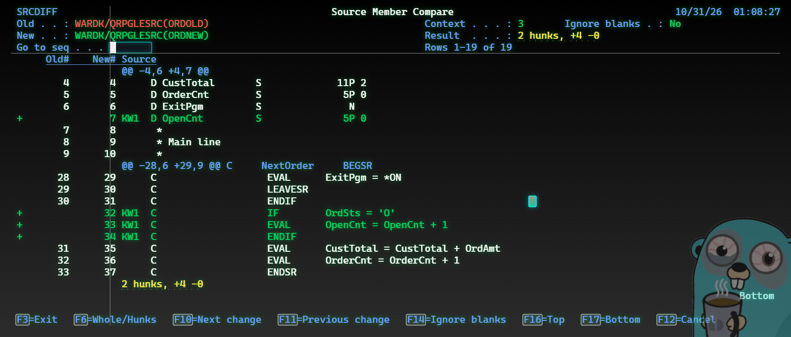

# SRCDIFF – git-style source compare for IBM i

Compare two source members on a plain 5250 screen, the way `git diff` shows it:
deleted lines in **red**, added lines in **green**, each block of changes under
an `@@` header that names the subroutine or procedure it sits in.

Pure ILE RPG, DDS and CL. No PASE, no open-source packages, no PC tools.
Runs on IBM i 7.3 or later.



## Install

1. Pick a library for it, e.g. `SRCDIFF`, with source files `QRPGLESRC`,
   `QDDSSRC`, `QCLLESRC` and `QCMDSRC`.
2. Upload the members from `src/`:

   | Source file | Member | Type |
   |---|---|---|
   | QRPGLESRC | SRCDIFF_H | RPGLE |
   | QRPGLESRC | SRCDIFFM | SQLRPGLE |
   | QRPGLESRC | SRCDIFFR | RPGLE |
   | QDDSSRC | SRCDIFFD | DSPF |
   | QDDSSRC | SRCDIFFD8 | DSPF |
   | QCLLESRC | SRCDIFFC | CLLE |
   | QCMDSRC | SRCDIFF | CMD |

3. Build. Either compile `build/BUILD.clle` and run it:

   ```
   CRTBNDCL PGM(SRCDIFF/BUILD) SRCFILE(SRCDIFF/QCLLESRC)
   CALL SRCDIFF/BUILD PARM('SRCDIFF' 'SRCDIFF')
   ```

   or run the commands in `build/build.sql` from ACS *Run SQL Scripts*.
4. Add the library to your library list.

Compiling from an editor instead? SRCDIFFM must be type SQLRPGLE and built as a
module (`CRTSQLRPGI OBJTYPE(*MODULE)`), and the command's program is SRCDIFFC.

## Use

```
SRCDIFF NEWFILE(DEVLIB/QRPGLESRC) NEWMBR(MYPGM) OLDFILE(PRODLIB/*NEWFILE)
```

The parameters match `CMPPFM`, so an existing PDM compare option only needs
the command name changed. A PDM option (F16 in `WRKMBRPDM`):

```
SRCDIFF NEWFILE(&L/&F) NEWMBR(&N) OLDFILE(PRODLIB/*NEWFILE)
```

`CONTEXT(n)` sets the unchanged lines around each change (default 3, `9999` for
the whole member). `IGNBLANK(*YES)` ignores changes that are only spacing.

| Key | Action |
|---|---|
| Page Up / Down | Scroll |
| F10 / F11 | Next / previous change |
| F6 | Whole member ↔ changes only |
| F14 | Ignore blanks on / off |
| F16 / F17 | Top / bottom |
| F19 / F20 | Shift text left / right (24x80) |
| Go to seq + Enter | Jump to a sequence number, e.g. `225.01` |
| F3 / F12 | Exit |

Old# and New# are the members' SRCSEQ numbers. A 27x132 session shows 113
columns of source; a 24x80 device gets a 24x80 screen automatically.

## How it works

The engine reads both members through SQL aliases in QTEMP and computes the
diff with patience diff plus Myers, the same approach git uses.
`tools/srcdiff_ref.py` is the same algorithm in Python, with tests
(`python -m unittest discover tests`); the optional `SRCDIFFT` driver writes the
RPG engine's output to a table so the two can be compared line for line.

Limits: 167,000 lines per member, 100 columns of source text.

## License

MIT
